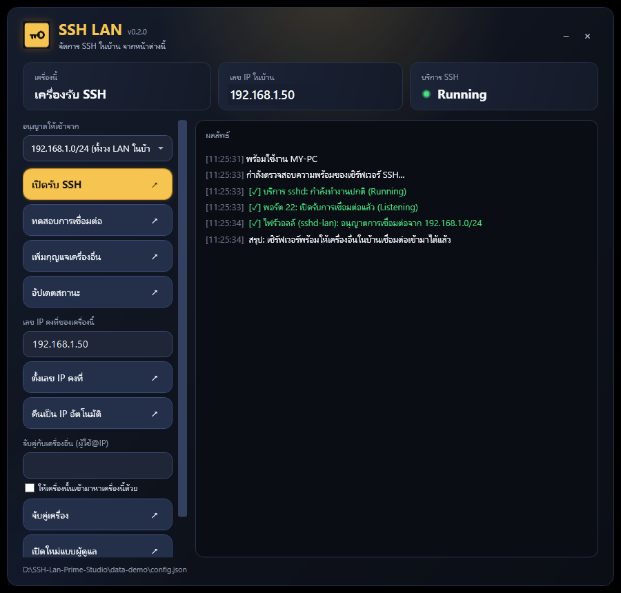

# SSH LAN

A small Windows desktop app that turns on SSH for your home network, safely, in a few clicks.
Key-only login, a firewall rule limited to your LAN, and an optional fixed IP address.

จัดการ SSH ในบ้านจากหน้าต่างเดียว: เปิดรับ SSH เฉพาะเครื่องในวง LAN, ล็อกอินด้วยกุญแจเท่านั้น และตั้งเลข IP คงที่เองได้
คู่มือภาษาไทย: [docs/SSH-LAN-TH.md](docs/SSH-LAN-TH.md)



## What it does

**On the PC that accepts SSH (the server)**

| Button | Effect |
|---|---|
| เปิดรับ SSH / Enable SSH | Starts `sshd`, allows TCP 22 only from the subnet you pick, turns password login off, keeps public-key login only, limits logins to your user |
| ทดสอบการเชื่อมต่อ / Test | Checks the service, port 22 and the firewall rule |
| เพิ่มกุญแจเครื่องอื่น / Add client key | Reads a public key from the clipboard and authorises it |
| ตั้งเลข IP คงที่ / Static IP | Pins this PC to the address you type (see below) |
| คืนเป็น IP อัตโนมัติ / DHCP | Hands the address back to the router |
| จับคู่เครื่อง / Pair | Puts this PC's public key on another machine (Windows, Linux or macOS) so it can SSH in; optionally lets that machine SSH back in (see below) |
| ปิดการรับ SSH / Disable | Stops `sshd` and removes the firewall rule |

**On a PC that connects (a client)** one click sets VS Code / Cursor to treat the host as Windows, writes the `~/.ssh/config` entry, checks your key and tests the connection.

The app picks the role by itself: a PC with the OpenSSH Server service installed is a server, anything else is a client.

## Requirements

- Windows 10/11, Windows PowerShell 5.1 (built in)
- Server side: the **OpenSSH Server** optional feature (Settings → Apps → Optional features)
- Administrator rights for anything that changes the system (the app has a button to relaunch as admin)

## Run

Build the launcher once, then double-click `SSH LAN.exe`:

```powershell
powershell -NoProfile -ExecutionPolicy Bypass -File scripts\build-launcher.ps1
```

It compiles `scripts\launcher.cs` with the `csc.exe` that ships with .NET Framework, so nothing needs installing.
Or skip the exe and run the app directly:

```powershell
powershell -NoProfile -STA -ExecutionPolicy Bypass -File scripts\app.ps1
```

## Fixed IP address

The static-IP box is pre-filled with your current address. Type a full address (`192.0.2.50`) or just the last number (`50`) and press **ตั้งเลข IP คงที่**.

Before touching anything the script checks that the address is in your subnet, is not the network, broadcast or router address, and that no other device answers on it. If applying fails it switches the adapter back to DHCP so the PC is never left without an address.

Good to know:

- This pins the address **on the PC**. The router can still hand the same number to another device. Pick a number outside the router's DHCP range, or add a DHCP reservation in the router as well.
- Use **คืนเป็น IP อัตโนมัติ** to go back to DHCP at any time.
- DNS stays as it was (the router is used if none was set).

## Pair machines

Pairing lets machines SSH into each other without you copying keys around. Type `user@address` of the other machine in the pair box (leave it empty and press the button to scan the LAN for machines that answer on port 22), press **จับคู่เครื่อง**, and type that machine's password in the window that opens (this program never sees it).

What happens: this PC makes its own key pair if it has none, puts the **public** key on the other machine, proves the key now opens the door, and writes a `Host` entry so `ssh <name>` works. The other machine can be **Windows, Linux or macOS**; the server's own banner tells Windows from the rest and the right commands are sent.

Tick **ให้เครื่องนั้นเข้ามาหาเครื่องนี้ด้วย** (`--both`) to make it two-way: the other machine makes its own key if needed, and its public key is allowed here. This PC must accept SSH for that (and run as administrator on Windows).

- Every machine keeps its own key pair. A private key never leaves the machine that made it.
- The first contact needs a login: the other machine must still allow password login. Harden turns it off, so **pair first, harden after**, or use a key the machine already trusts.
- A target that already has the key is left as it is (no duplicate line).

## Command line

The same logic is available without the window.

Windows: `scripts\ssh-lan\ssh-lan.ps1` (menu) or with `-Action help|status|harden|add-client|remove|client|pair`

```powershell
.\scripts\ssh-lan\ssh-lan.ps1 -Action harden -Subnet 192.0.2.0/24
.\scripts\ssh-lan\ssh-lan.ps1 -Action pair -Target alice@192.0.2.20 -Both
.\scripts\ssh-lan\set-lan-ip.ps1 -Ip 50      # or -Dhcp
```

Linux and macOS: `scripts/ssh-lan/ssh-lan.sh`

```bash
chmod +x scripts/ssh-lan/ssh-lan.sh && scripts/ssh-lan/ssh-lan.sh
scripts/ssh-lan/ssh-lan.sh pair --target alice@192.0.2.20 --both
```

macOS: client, pairing and LAN discovery are supported (BSD `sed`, `ifconfig` and `arp` are handled). Turning a Mac into a hardened server is partial: the `sshd_config.d` drop-in is written, but Remote Login must be switched on in System Settings and there is no firewall step. Not tested on a Mac yet.

## Settings

Stored outside the repo in `%LocalAppData%\Ssh-Lan-Prime-Studio\config.json` (or the folder in `SSH_LAN_DATA_DIR` / `"SSH LAN.exe" --data-dir <folder>`).

| Key | Meaning | Default |
|---|---|---|
| `hostAlias` | Name used in `~/.ssh/config`, e.g. `ssh ssh-lan hostname` | `ssh-lan` |
| `identityFile` | Key file name in `~/.ssh` | `id_ed25519_lan` |
| `serverUser` | Account the client logs in as on the server | current user |
| `serverHost` | Optional name of the server (DNS / mDNS) | empty |
| `serverIpSearch` | Optional extra addresses to try first | empty |

Nothing about your machines is hard-coded. A client finds the server by itself: the address saved in `~/.ssh/config`, then `SSH_SERVER_IP`, `serverHost` and `serverIpSearch`, and if none answers it scans its own /24 for port 22 and keeps the host your key opens. Any private range works (`10.x`, `172.16-31.x`, `192.168.x`), and the "allow from" choices use your real prefix length. The Linux script takes the same settings as `SSH_HOST_ALIAS`, `SSH_IDENTITY`, `SSH_SERVER_USER`, `SSH_SERVER_HOST`, `SSH_SERVER_IP` and `SSH_SERVER_IP_SEARCH`.

## Version

Current version: **0.2.0** (adds pairing and macOS support; 0.1.0 was the first release). It lives in [`VERSION`](VERSION) and is shown in the window title, the Linux menu and the built exe's file properties. Change that file (and the version in `scripts/app.manifest`) to release a new one.

## Security notes

- Nothing secret is stored in this repo. Keys live in your own `~/.ssh`, settings in `%LocalAppData%`.
- Hardening writes `PasswordAuthentication no`, `AuthenticationMethods publickey`, `MaxAuthTries 3` and `AllowUsers <you>` to `sshd_config`, after saving a timestamped backup next to it.
- Clients connect with `StrictHostKeyChecking accept-new`: the first connection to a host is trusted, later key changes are refused.
- Every machine makes its own key pair; pairing sends only public keys, and a private key is never copied from another machine.
- The launcher starts PowerShell with an execution-policy bypass for this one script only.

## Layout

```
scripts/app.ps1            window logic
VERSION                    release number
scripts/ssh-lan-ui.xaml    look and motion
scripts/ssh-lan/           core: ssh-lan.ps1, ssh-lan.sh, set-lan-ip.ps1
scripts/launcher.cs        tiny exe that starts app.ps1
scripts/build-launcher.ps1 builds the icon and the exe
assets/                    logo and icon
```

## License

[MIT](LICENSE) © 2026 settanun-prime
