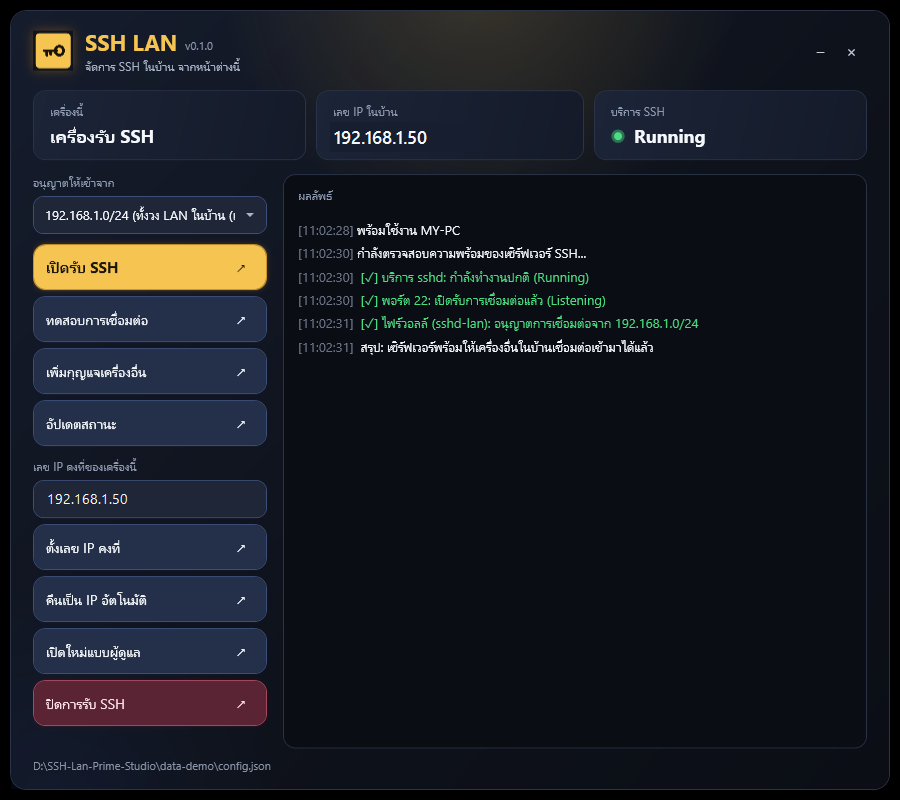

# SSH LAN

A small Windows desktop app that turns on SSH for your home or office network, safely, in a few clicks.
A firewall rule limited to your LAN, key login, an optional fixed IP address, a scanner that lists every device on the router (cable and Wi-Fi) and acts on it, and a one-touch invite that installs SSH on a new machine and pairs it.

จัดการ SSH ในบ้านและออฟฟิศจากหน้าต่างเดียว: เปิดรับ SSH เฉพาะวง LAN, ล็อกอินด้วยกุญแจ, ตั้งเลข IP คงที่, สแกนทุกเครื่องในวงเราเตอร์ (สายแลนและ Wi-Fi) แล้วสั่งงานได้ และเชิญเครื่องใหม่เข้าวงด้วยการแตะเครื่องนั้นครั้งเดียว
คู่มือภาษาไทย: [docs/SSH-LAN-TH.md](docs/SSH-LAN-TH.md)



## What it does

**On the PC that accepts SSH (the server)**

| Button | Effect |
|---|---|
| เปิดรับ SSH / Enable SSH | Starts `sshd`, allows TCP 22 only from the subnet you pick, turns password login off, keeps public-key login only, limits logins to your user |
| ทดสอบการเชื่อมต่อ / Test | Checks the service, port 22 and the firewall rule |
| เพิ่มกุญแจเครื่องอื่น / Add client key | Reads a public key from the clipboard and authorises it |
| ตั้งเลข IP คงที่ / Static IP | Pins this PC to the address you type (see below) |
| คืนเป็น IP อัตโนมัติ / DHCP | Hands the address back to the router |
| จับคู่เครื่อง / Pair | Puts this PC's public key on another machine (Windows, Linux or macOS) so it can SSH in; optionally lets that machine SSH back in (see below) |
| แผนผังเครือข่าย / Map | Opens the network map: every device found, its kind, how it connects and its audit colour (see below) |
| สแกน / ควบคุมเครื่องใน LAN / Scan | Opens the scanner window: every device on the router, SSH/RDP/web/share/Wake-on-LAN/commands on the selected one, connection diagnosis, inviting new machines and the security audit (see below) |
| ปิดการรับ SSH / Disable | Stops `sshd` and removes the firewall rule |

**On a PC that connects (a client)** one click sets VS Code / Cursor to treat the host as Windows, writes the `~/.ssh/config` entry, checks your key and tests the connection.

The app picks the role by itself: a PC with the OpenSSH Server service installed is a server, anything else is a client.

## Requirements

- Windows 10/11, Windows PowerShell 5.1 (built in)
- Server side: the **OpenSSH Server** optional feature (Settings → Apps → Optional features)
- Administrator rights for anything that changes the system (the app has a button to relaunch as admin)

## Run

Build the launcher once, then double-click `SSH LAN.exe`:

```powershell
powershell -NoProfile -ExecutionPolicy Bypass -File scripts\build-launcher.ps1
```

It compiles `scripts\launcher.cs` with the `csc.exe` that ships with .NET Framework, so nothing needs installing.
Or skip the exe and run the app directly:

```powershell
powershell -NoProfile -STA -ExecutionPolicy Bypass -File scripts\app.ps1
```

## Fixed IP address

The static-IP box is pre-filled with your current address. Type a full address (`192.0.2.50`) or just the last number (`50`) and press **ตั้งเลข IP คงที่**.

Before touching anything the script checks that the address is in your subnet, is not the network, broadcast or router address, and that no other device answers on it. If applying fails it switches the adapter back to DHCP so the PC is never left without an address.

Good to know:

- This pins the address **on the PC**. The router can still hand the same number to another device. Pick a number outside the router's DHCP range, or add a DHCP reservation in the router as well.
- Use **คืนเป็น IP อัตโนมัติ** to go back to DHCP at any time.
- DNS stays as it was (the router is used if none was set).

## Pair machines

Pairing lets machines SSH into each other without you copying keys around. Type `user@address` of the other machine in the pair box (leave it empty and press the button to scan the LAN for machines that answer on port 22), press **จับคู่เครื่อง**, and type that machine's password in the window that opens (this program never sees it).

What happens: this PC makes its own key pair if it has none, puts the **public** key on the other machine, proves the key now opens the door, and writes a `Host` entry so `ssh <name>` works. The other machine can be **Windows, Linux or macOS**; the server's own banner tells Windows from the rest and the right commands are sent.

Tick **ให้เครื่องนั้นเข้ามาหาเครื่องนี้ด้วย** (`--both`) to make it two-way: the other machine makes its own key if needed, and its public key is allowed here. This PC must accept SSH for that (and run as administrator on Windows).

- Every machine keeps its own key pair. A private key never leaves the machine that made it.
- The first contact needs a login: the other machine must still allow password login. Harden turns it off, so **pair first, harden after**, or use a key the machine already trusts.
- A target that already has the key is left as it is (no duplicate line).

## LAN scanner and control

**สแกน / ควบคุมเครื่องใน LAN** opens a scanner window, similar to an IP scanner: every device on the router's network, wired or Wi-Fi, with name, IP, MAC, a guess at the OS, open services (SSH, HTTP, HTTPS, SMB, RDP, VNC, 8080, plus FTP, Telnet, printers, cameras, MQTT, Chromecast, NAS and the industrial ports Modbus, S7, EtherNet/IP, OPC UA and BACnet) and whether it is already paired.

Leave the range empty to scan every private network this PC is on, or type `192.0.2.0/24` or `192.0.2.1-254`. One sweep takes about 10 seconds: ping, a TCP check of the ports above, the ARP table (finds devices that block ping), reverse DNS and NetBIOS names. Devices seen before stay listed as offline, so Wake-on-LAN still knows their MAC (`devices.json` next to `config.json`).

On the selected device: open an SSH terminal (double-click the row), pair (two-way by default), Remote Desktop, web page, file shares, Wake-on-LAN, copy IP, run a command over SSH, restart or shut down (asks first). Commands, restart and shutdown use your key, so pair first; on Linux/macOS power commands need `sudo` without a password.

The scanner borrows two habits from [REA](https://github.com/morluto/rea), a reverse-engineering tool:

- **Evidence first.** The หลักฐาน column says what proved each finding (`ตอบ: ping + ARP + port 22`, `ชื่อ: NetBIOS`, the SSH banner, the device's web title or `Server` header). Anything that was not proven stays blank, so the table never presents a guess as fact. A MAC with the locally-administered bit set is flagged as random (usually a phone).
- **Find the blocker, then fix it.** **ตรวจว่าทำไมเข้าไม่ได้** checks one layer at a time (ping, port 22, banner, this PC's key, the login methods the server offers) and stops at the first failure with the fix for that layer.

**ให้เครื่องนี้มองเห็นในวง LAN** (admin) sets the network to Private, turns on Network Discovery, file and printer sharing and ping for the local subnet only, and starts the discovery services.

Wi-Fi devices can only be seen when the router does not isolate them: turn off "AP isolation" / "client isolation" / guest network for the devices that should see each other.

## Network map

The map is the first thing the main window shows (tab **แผนผังเครือข่าย**; the log of what each button did is the **ผลลัพธ์** tab, which opens by itself when a task runs). It draws every device the scan, the latest security audit and Tailscale actually found. Nothing is invented: 4 devices found means 4 on the map, none means "ยังไม่พบเครื่อง กดสแกน".

- **Two views.** Up to 12 devices: the router in the middle, the internet top left, Tailscale machines that are not on this LAN top right, and cabling down to each device in rows sorted by IP. More than 12: 80×66 tiles grouped by IP range, name prefix or kind. Switch views yourself; the same data always draws the same picture.
- **Icons from evidence.** Router = default gateway; desktop / laptop / server = the chassis type the machine reports (this PC reads its own, paired machines through the audit), or a Linux box that boots to `multi-user.target`; printer = ports 631/9100/515; camera = 554; TV = 8008/8009/7000; NAS = 5000/5001 with 445; PLC = 502/102/44818; HMI = a name starting with HMI; phone = Tailscale says android/iOS, or a random MAC with no open port. Anything else is "ไม่ทราบชนิด". Pick a kind yourself in the side panel and it is kept in `devices.json`.
- **Lines.** Solid = cable, dashed = Wi-Fi, faint dots = not known (only audited machines report it). Green with a running dot = paired over SSH. A purple **TS** mark on a box means that machine is on the tailnet (not that every peer can reach every service — check ports in the side panel). Off-LAN Tailscale peers sit in the top-right group. The corner dot is the device's audit colour.
- **Hover** a device for a card; **click** it for the full record (names and where each came from, kind and its evidence, addresses, ports with their audit colour, SSH pairing) with buttons for SSH, pairing, diagnosis, the audit and the kind.
- **Motion** has one meaning each: a cable drawing out and a device floating up = found, tiles sliding = regrouped, running dot = data can flow, slow pulse = online, slow red blink = a risky port. Known devices do not replay it when the map refreshes (every 30 seconds while the window is in front). With Windows' "show animations" off, the map stays still.

## Security audit

**ตรวจความปลอดภัย** in the scanner window (or `-Action audit`) checks every device the scan found and says, per open port, who can reach it and whether that is safe. It changes nothing on any machine: no firewall rule, service or setting is touched.

| Colour | Meaning |
|---|---|
| แดง (red) | Fix now: Telnet/FTP, SMBv1, SSH that still takes passwords, Remote Desktop without NLA, a firewall that is off, an allow-anyone rule on a Public network, a port forwarded from the internet, a machine port (Modbus, S7, ...) reachable from another network or Tailscale |
| เหลือง (amber) | Check it is meant to be open: Remote Desktop, VNC or SMB open to the LAN, a program listening for the network that is not a known service, a device's web page (default passwords), UPnP left on at the router |
| เขียว (green) | Fine: listens on this machine only, blocked by the firewall, or limited to the LAN with a key |
| เทา (gray) | Could not tell: the machine is off, SSH to it failed, or a device's port is open but nothing more is known. The reason is always shown |

Every row carries its evidence (the firewall rule, listening address, process, what the scan saw) and a one-line fix. Hover a row to read both in full.

Where the facts come from:

- **This PC**: listening ports with their process (`Get-NetTCPConnection`), every inbound firewall rule through the firewall's COM API (no admin needed; matched by ports, program, service, addresses and Store-app owner, never by the translated display name), the network profile, `sshd_config`, SMB 1 and the Remote Desktop NLA setting.
- **Paired machines** (a `Host` alias in `~/.ssh/config`): the same collector over SSH with your key, eight machines at a time, 20 seconds each at most. Windows gets the script on stdin as base64; Linux runs a small `sh` script (`ss -ltnp`, `ufw`, `sshd -T`) and uses `sudo -n` only when it needs no password. A machine that is off or refuses comes back gray with the SSH error.
- **Other devices**: only what the scan saw from outside, so there is no process name.
- **The router**: UPnP IGD (SSDP, then `GetExternalIPAddress` and the port-mapping list) answers within about 5 seconds or the result stays unknown. A WAN address in a private or `100.64.0.0/10` range means CGNAT: port forwards cannot reach you from the internet. The public address comes from `tailscale netcheck`; no third-party "what is my IP" site is asked.
- **From outside** (optional): with an Android phone in your tailnet offering itself as an exit node, **ทดสอบจากข้างนอก (exit node)** routes this PC through the phone for about a minute, knocks your public address on each audited port, and always switches the exit node back, even after an error.

Each round is saved as `audit-YYYYMMDD-HHmm.json` next to `config.json`; rows that were not in the previous round are marked ใหม่.

**Safe ranges.** Machines on a production line can misbehave when probed. List their network in `ranges.json` next to `config.json` and the scanner sends them only ARP and at most 20 pings a second, never a TCP packet:

```json
[{ "cidr": "10.10.0.0/24", "safe": true, "label": "สายการผลิต" }]
```

## Invite machines

Bring a new machine in with one touch on that machine. Run the app as administrator and open the scanner window.

**เชิญเครื่อง (link, same LAN or Tailscale)** opens a 15-minute invite: a small web server on port 8765, allowed by a temporary firewall rule (`sshlan-invite`) only from the local subnet and `100.64.0.0/10`. The panel shows a link, a Linux/macOS one-liner and a 6-character **confirm code**.

- Windows: open the link on the new PC, run the downloaded `join.cmd` and approve the admin prompt. Linux/macOS: paste the `curl … | sh` line.
- The new machine shows the confirm code; check it matches this screen. It is derived from this PC's public key, so it catches a swapped key. It does not stop a machine on the LAN that intercepts the download itself (the link is plain HTTP): for sensitive machines use the USB package.
- Before anything is trusted, this PC asks you to approve each machine that answers, showing its name, address and the code of **its** key (also printed on that machine). An alias you already use for another address is never re-pointed.
- It installs OpenSSH Server and SSH LAN (`%LocalAppData%\Programs\SSH LAN`), allows port 22 from the LAN and Tailscale only, trusts this PC's public key, makes its own key and sends its **public** key back. Tick **ลง Tailscale ด้วย** to install Tailscale as well.
- This PC proves its key opens the new machine, adds `ssh <name>` and allows the new machine back in. Password login keeps working as before. Tick **ใช้กุญแจอย่างเดียว** (CLI `-KeyOnly`) to turn passwords off there after the key test passes.
- The package is checked against a SHA-256 hash before anything is installed. Every step on the new machine is logged to `%LocalAppData%\Ssh-Lan-Prime-Studio\join.log`.
- The link, the server and the firewall rule close at the end of the 15 minutes, on **หยุดเชิญ**, or when the app closes; a rule left by a crash is removed the next time the app starts as administrator.

**สร้างชุดติดตั้ง USB** writes the same installer to a folder (a USB stick, a share) for machines that are not on the same network yet. Run `join.cmd` there, then in the scanner select that machine and press **จับคู่**: this PC's key already opens it, so pairing back needs no password.

## Command line

The same logic is available without the window.

Windows: `scripts\ssh-lan\ssh-lan.ps1` (menu) or with `-Action help|status|harden|add-client|remove|client|pair`

```powershell
.\scripts\ssh-lan\ssh-lan.ps1 -Action harden -Subnet 192.0.2.0/24
.\scripts\ssh-lan\ssh-lan.ps1 -Action pair -Target alice@192.0.2.20 -Both
.\scripts\ssh-lan\set-lan-ip.ps1 -Ip 50      # or -Dhcp
.\scripts\ssh-lan\ssh-lan.ps1 -Action scan   # or -Range 192.0.2.1-254
.\scripts\ssh-lan\ssh-lan.ps1 -Action audit  # read-only security audit, -Range as for scan
.\scripts\ssh-lan\ssh-lan.ps1 -Action run -Target alias -Command hostname
.\scripts\ssh-lan\ssh-lan.ps1 -Action diagnose -Target 192.0.2.20 -AsUser alice
.\scripts\ssh-lan\ssh-lan.ps1 -Action wake -Mac 02-11-22-33-44-55
.\scripts\ssh-lan\ssh-lan.ps1 -Action discoverable
.\scripts\ssh-lan\ssh-lan.ps1 -Action invite      # -Minutes 15, -Tailscale, -KeyOnly, or -Usb E:\ for a USB package
```

Tests: `powershell -File tests\run.ps1` (each `tests\*.tests.ps1` runs in its own Windows PowerShell 5.1).

Linux and macOS: `scripts/ssh-lan/ssh-lan.sh`

```bash
chmod +x scripts/ssh-lan/ssh-lan.sh && scripts/ssh-lan/ssh-lan.sh
scripts/ssh-lan/ssh-lan.sh pair --target alice@192.0.2.20 --both
```

macOS: client, pairing and LAN discovery are supported (BSD `sed`, `ifconfig` and `arp` are handled). Turning a Mac into a hardened server is partial: the `sshd_config.d` drop-in is written, but Remote Login must be switched on in System Settings and there is no firewall step. Not tested on a Mac yet.

## Settings

Stored outside the repo in `%LocalAppData%\Ssh-Lan-Prime-Studio\config.json` (or the folder in `SSH_LAN_DATA_DIR` / `"SSH LAN.exe" --data-dir <folder>`).

| Key | Meaning | Default |
|---|---|---|
| `hostAlias` | Name used in `~/.ssh/config`, e.g. `ssh ssh-lan hostname` | `ssh-lan` |
| `identityFile` | Key file name in `~/.ssh` | `id_ed25519_lan` |
| `serverUser` | Account the client logs in as on the server | current user |
| `serverHost` | Optional name of the server (DNS / mDNS) | empty |
| `serverIpSearch` | Optional extra addresses to try first | empty |

Nothing about your machines is hard-coded. A client finds the server by itself: the address saved in `~/.ssh/config`, then `SSH_SERVER_IP`, `serverHost` and `serverIpSearch`, and if none answers it scans its own /24 for port 22 and keeps the host your key opens. Any private range works (`10.x`, `172.16-31.x`, `192.168.x`), and the "allow from" choices use your real prefix length. The Linux script takes the same settings as `SSH_HOST_ALIAS`, `SSH_IDENTITY`, `SSH_SERVER_USER`, `SSH_SERVER_HOST`, `SSH_SERVER_IP` and `SSH_SERVER_IP_SEARCH`.

## Version

Current version: **0.6.38** (adds the network map; 0.5.0 added the security audit, 0.4.0 inviting machines, 0.3.0 added the LAN scanner and device control, 0.2.0 pairing and macOS, 0.1.0 was the first release). The **รีเฟรช** button in the window header reopens the app on the code in its folder; when `VERSION` there is newer than the running window it turns yellow and reads **อัปเดตเป็น vX** (checked every 10 seconds, an admin window comes back as admin). The version lives in [`VERSION`](VERSION) and is shown in the window title, the Linux menu and the built exe's file properties. Change that file (and the version in `scripts/app.manifest`) to release a new one.

## Security notes

- Nothing secret is stored in this repo. Keys live in your own `~/.ssh`, settings in `%LocalAppData%`.
- Hardening writes `PasswordAuthentication no`, `AuthenticationMethods publickey`, `MaxAuthTries 3` and `AllowUsers <you>` to `sshd_config`, after saving a timestamped backup next to it.
- Clients connect with `StrictHostKeyChecking accept-new`: the first connection to a host is trusted, later key changes are refused.
- Every machine makes its own key pair; pairing sends only public keys, and a private key is never copied from another machine.
- The launcher starts PowerShell with an execution-policy bypass for this one script only.

## Layout

```
scripts/app.ps1            window logic
VERSION                    release number
scripts/ssh-lan-ui.xaml    look and motion
scripts/scan-ui.ps1        LAN scanner window logic (ssh-lan-scan.xaml)
scripts/audit-ui.ps1       security audit window logic (ssh-lan-audit.xaml)
scripts/topology-ui.ps1    network map window (ssh-lan-topology.xaml)
scripts/ssh-lan/topology.ps1 map data: device kinds, nodes from real data, fixed layout
scripts/ssh-lan/audit*.ps1 audit: colour rules, fact collectors, the audit round
scripts/ssh-lan/fleet.ps1  runs work on many machines at once with a time limit each
scripts/ssh-lan/router.ps1 UPnP IGD, CGNAT, public address, exit-node probe
scripts/ssh-lan/           core: ssh-lan.ps1, ssh-lan.sh, set-lan-ip.ps1
scripts/ssh-lan/invite.ps1 invite server, join package, pairing a joined machine
scripts/ssh-lan/join.ps1   runs on the joining machine (started by join.cmd)
scripts/ssh-lan/join.*.template  join.cmd (Windows) and join.sh (Linux/macOS)
tests/                     run.ps1 runs every *.tests.ps1 in Windows PowerShell 5.1
scripts/launcher.cs        tiny exe that starts app.ps1
scripts/build-launcher.ps1 builds the icon and the exe
assets/                    logo and icon
```

## License

[MIT](LICENSE) © 2026 settanun-prime
